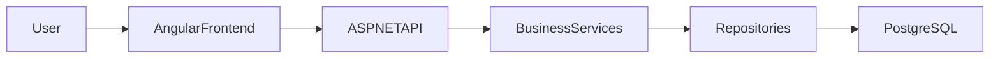
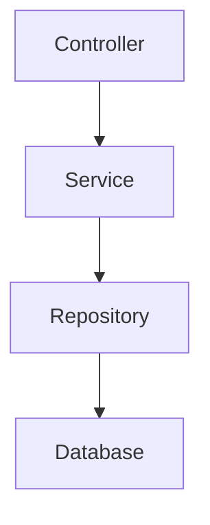
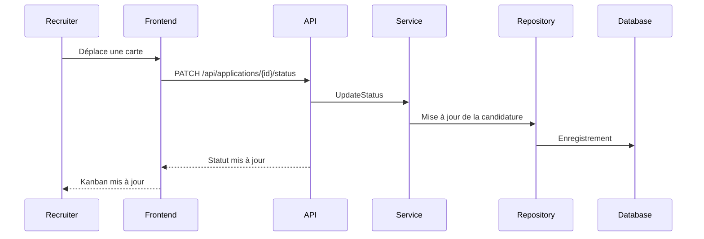
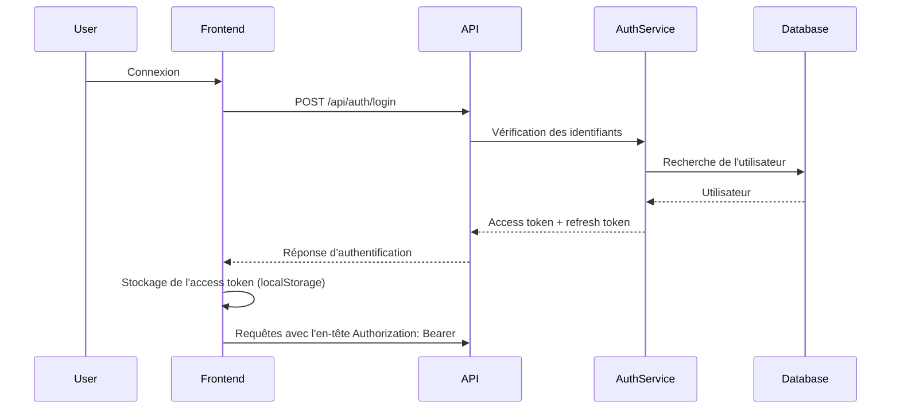
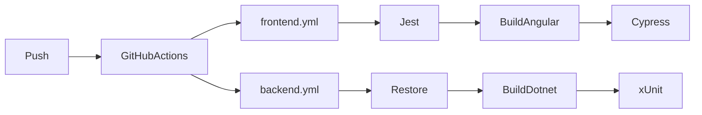

# RecruitFlow

Plateforme de gestion du recrutement. Elle permet de gérer les offres d'emploi, de suivre les candidatures dans un tableau Kanban, de planifier des entretiens, de les évaluer et de suivre l'activité dans un tableau de bord.

- Application : https://recruit-flow-front.web.app
- API : https://recruitflow-production.up.railway.app
- Swagger : https://recruitflow-production.up.railway.app/swagger

## Fonctionnalités

- Gestion des offres d'emploi (création, modification, publication, fermeture)
- Suivi des candidatures, avec un Kanban en glisser-déposer
- Planification et suivi des entretiens (téléphone, vidéo, sur place)
- Évaluation des entretiens avec une grille de scoring et une recommandation
- Tableau de bord avec statistiques (Chart.js)
- Authentification JWT avec trois rôles : Admin, Recruiter, Candidate

## Stack technique

| Couche | Technologies |
|--------|--------------|
| Frontend | Angular 19 (standalone components, signals), RxJS, Chart.js, SCSS |
| Backend | ASP.NET Core 8, Entity Framework Core 8, C# 12 |
| Base de données | PostgreSQL 16 |
| Authentification | JWT (HS256), BCrypt |
| Tests | Jest, Cypress, xUnit, Moq |
| CI/CD | GitHub Actions |
| Hébergement | Firebase Hosting (frontend), Railway (API + PostgreSQL) |

## Architecture



Le backend suit une Clean Architecture : les dépendances pointent vers `RecruitFlow.Core`.



| Couche | Projet | Responsabilité |
|--------|--------|----------------|
| API | `RecruitFlow.API` | Controllers, middleware, configuration (`Program.cs`) |
| Core | `RecruitFlow.Core` | Entités, interfaces, DTOs |
| Infrastructure | `RecruitFlow.Infrastructure` | `AppDbContext`, repositories, services métier, seed, migrations |

## Structure du projet

```text
RecruitFlow
├── recruit-flow-front          Application Angular
├── RecruitFlow.API             API ASP.NET Core
├── RecruitFlow.Core            Entités, interfaces, DTOs
├── RecruitFlow.Infrastructure  AppDbContext, repositories, services, seed
└── RecruitFlow.Tests           Tests unitaires backend
```

## API

Toutes les routes sont préfixées par `/api`. Le détail est disponible dans Swagger.

| Ressource | Routes principales |
|-----------|--------------------|
| `auth` | `POST /register`, `POST /login`, `POST /refresh`, `POST /revoke` |
| `jobs` | CRUD, `GET /published`, `PATCH /{id}/status` |
| `applications` | `GET`, `POST`, `PATCH /{id}/status`, `POST /{id}/withdraw` |
| `interviews` | CRUD partiel, `POST /{id}/cancel`, `PATCH /{id}/complete` |
| `evaluations` | `GET`, `POST`, `PUT /{id}`, `GET /interview/{interviewId}` |
| `dashboard` | `GET` (statistiques agrégées) |

## Statuts d'une candidature

`Pending`, `Reviewing`, `Interview`, `Offer`, `Rejected`, `Withdrawn`.

Les recruteurs changent le statut en déplaçant les cartes dans le Kanban.



## Authentification



- Access token de 15 minutes
- Refresh token de 7 jours, stocké en base sous forme de hash SHA-256
- Mots de passe hachés avec BCrypt
- Accès aux routes limité par rôle (`[Authorize(Roles = ...)]`)

## Tests et CI/CD

| Type | Outil | Emplacement |
|------|-------|-------------|
| Unitaires frontend | Jest | `recruit-flow-front/src/app/core/services/*.spec.ts` |
| End-to-end | Cypress | `recruit-flow-front/cypress/e2e/` (login, création d'offre, Kanban) |
| Unitaires backend | xUnit + Moq | `RecruitFlow.Tests/Services/` |

Deux workflows GitHub Actions s'exécutent à chaque push et pull request sur `main` :

- `frontend.yml` : installation, tests Jest, build Angular de production, démarrage de l'API avec PostgreSQL 16, puis tests Cypress
- `backend.yml` : restore, build et tests xUnit



## Déploiement

- Frontend : build Angular de production, publié sur Firebase Hosting (`firebase.json`, redirection de toutes les routes vers `index.html`)
- API et base de données : Railway, construction avec le `Dockerfile` à la racine du dépôt
- Au démarrage, l'API applique les migrations et exécute le seed

L'URL de l'API utilisée en production est définie dans `recruit-flow-front/src/environments/environment.prod.ts`.

## Installation locale

Prérequis : .NET 8 SDK, Node.js 20 ou plus, PostgreSQL 16.

```bash
git clone https://github.com/seydi-dev/recruitflow.git
cd recruitflow
```

### Backend

Renseigner la configuration dans `RecruitFlow.API/appsettings.Development.json` :
`ConnectionStrings:DefaultConnection`, `Jwt:Secret`, `Jwt:Issuer`, `Jwt:Audience` et `Cors:AllowedOrigins`.

```bash
cd RecruitFlow.API
dotnet restore
dotnet run
```

Les migrations et le seed sont appliqués au démarrage. L'API est disponible sur `http://localhost:5072` et Swagger sur `http://localhost:5072/swagger`.

### Frontend

```bash
cd recruit-flow-front
npm install
npm start
```

Application disponible sur `http://localhost:4200`.

### Lancer les tests

```bash
# Frontend (Jest)
cd recruit-flow-front
npm test

# End-to-end (API et frontend démarrés)
npm run cypress:run

# Backend (xUnit)
dotnet test RecruitFlow.Tests/RecruitFlow.Tests.csproj
```

## Améliorations futures

- Notifications en temps réel
- Tri intelligent des candidatures
- Analyses avancées du recrutement
- Intégration email
- Application mobile

## Auteur

Seydi Ahmeth Ndiaye — Baccalauréat en génie logiciel, UQTR (promotion 2025)

https://www.linkedin.com/in/seydi-ahmeth-ndiaye

## Licence

Projet éducatif et portfolio.
